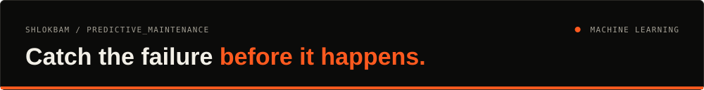
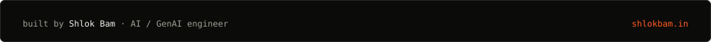

<div align="center">




<a href="https://predictive-maintenance-hx97.onrender.com/">Live app</a> · <a href="#what-it-does">What it does</a> · <a href="#results">Results</a> · <a href="#run-it">Run it</a> · <a href="docs/DETAILS.md">Full notes</a>

</div>

Predicts machine failure from sensor readings (temperatures, rotational speed, torque, tool wear) using 10,000 records where only 3.4% are failures, then serves the hybrid model in a Flask app.

## What it does

- **Explores and balances the data:** EDA on the raw set, then SMOTE to lift failures from 339 to 9,661 so models don't just predict "no failure".
- **Normalises features** with `StandardScaler`.
- **Trains and compares five models:** logistic regression, KNN, decision tree, random forest, and a voting hybrid of random forest + KNN, with confusion matrices and ROC curves for each.
- **Serves predictions** in a small Flask site.

## Results

| Model | Accuracy | Precision | Recall | F1 |
| :--- | :--- | :--- | :--- | :--- |
| Hybrid (RF + KNN) | **0.975** | **0.973** | 0.976 | **0.975** |
| Random forest | 0.974 | 0.964 | 0.983 | 0.974 |
| Decision tree | 0.959 | 0.953 | 0.966 | 0.959 |
| KNN | 0.957 | 0.931 | **0.987** | 0.958 |
| Logistic regression | 0.835 | 0.844 | 0.823 | 0.833 |

⚠️ SMOTE was applied before the train/test split, so the test set contains synthetic failures and these scores are optimistic. Re-splitting first and oversampling only the training set is on the roadmap below.

## Stack

| Area | Tools |
| :--- | :--- |
| Data | pandas, NumPy, imbalanced-learn (SMOTE) |
| Models | scikit-learn |
| Charts | Matplotlib |
| App | Flask, gunicorn, Render |

## Run it

```bash
pip install -r requirements.txt
python data_processing/smote_balance.py         # balance
python data_processing/normalize_dataset.py     # scale
python phase2_models/models/hybrid_model.py     # train (update the CSV path at the top of each script)
gunicorn --chdir predictive_maintenance_site app:app
```

## Roadmap

- [ ] Split before SMOTE and report scores on real, untouched failures only
- [ ] Replace the hard-coded local data paths with relative ones

---

<div align="center">

<a href="https://shlokbam.in"></a>

<a href="https://shlokbam.in">shlokbam.in</a> · <a href="https://www.linkedin.com/in/shlokbam/">LinkedIn</a> · <a href="https://github.com/shlokbam">More projects</a>

</div>
